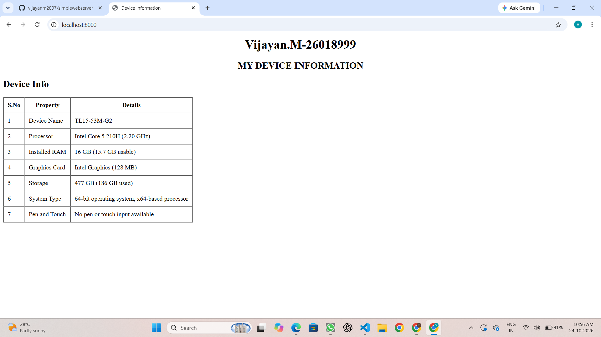
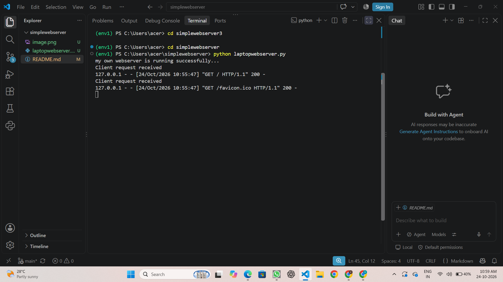

# EX01 Developing a Simple Webserver
## Date:28.09.2026

## AIM:
To develop a simple webserver to serve html pages and display the Windows Specifications of your Laptop.

## DESIGN STEPS:
### Step 1: 
HTML content creation.

### Step 2:
Design of webserver workflow.

### Step 3:
Implementation using Python code.

### Step 4:
Import the necessary modules.

### Step 5:
Define a custom request handler.

### Step 6:
Start an HTTP server on a specific port.

### Step 7:
Run the Python script to serve web pages.

### Step 8:
Serve the HTML pages.

### Step 9:
Start the server script and check for errors.

### Step 10:
Open a browser and navigate to http://127.0.0.1:8000 (or the assigned port).

## PROGRAM:
```
laptopwebserver.py
from http.server import HTTPServer, BaseHTTPRequestHandler
content = """
<html>
       <head>
    <title>Device Information</title>
       </head>
<body>
     <h1 align="center">Vijayan.M-26018999</h1>

    <h2 align="center">MY DEVICE INFORMATION</h2>
    <h2>Device Info</h2>

    <table border="1" cellpadding="10" cellspacing="0">
        <tr>
            <th>S.No</th>
            <th>Property</th>
            <th>Details</th>
        </tr>
        <tr>
            <td>1</td>
            <td>Device Name</td>
            <td>TL15-53M-G2</td>
        </tr>
        <tr>
            <td>2</td>
            <td>Processor</td>
            <td>Intel Core 5 210H (2.20 GHz)</td>
        </tr>
        <tr>
            <td>3</td>
            <td>Installed RAM</td>
            <td>16 GB (15.7 GB usable)</td>
        </tr>
        <tr>
            <td>4</td>
            <td>Graphics Card</td>
            <td>Intel Graphics (128 MB)</td>
        </tr>
        <tr>
            <td>5</td>
            <td>Storage</td>
            <td>477 GB (186 GB used)</td>
        </tr>
        <tr>
            <td>6</td>
            <td>System Type</td>
            <td>64-bit operating system, x64-based processor</td>
        </tr>
        <tr>
            <td>7</td>
            <td>Pen and Touch</td>
            <td>No pen or touch input available</td>
        </tr>
    </table>

</body> 
</html>
"""
class myhandler(BaseHTTPRequestHandler):
    def do_GET(self):
        print("Client request received")
        self.send_response(200)
        self.send_header('content-type', 'text/html; charset=utf-8')
        self.end_headers()
        self.wfile.write(content.encode())
server_address = ('',8000)
httpd = HTTPServer(server_address,myhandler)
print("my own webserver is running successfully...")
httpd.serve_forever()
```

## OUTPUT:
webpage


server page


## RESULT:
The program for implementing simple webserver is executed successfully.
